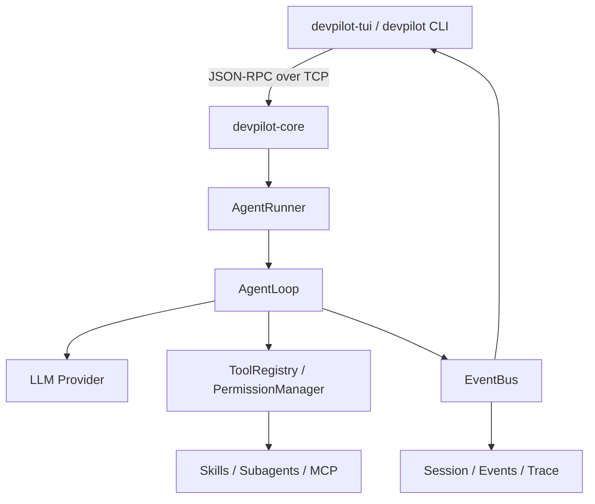

# DevPilot

DevPilot 是一个 Python 实现的本地 AI Agent 项目，由 `devpilot-core` 守护进程和终端交互界面 `devpilot-tui` 组成，通过 TCP 通信。`devpilot` CLI 用于连通性检查和脚本调试。

## 环境要求

- Python **3.12**（项目要求 `>=3.12,<3.13`）。
- `uv`，用于安装依赖和运行项目。
- 可用的智谱 API 密钥，以及对应模型的访问权限。

以下命令均在项目根目录（包含 `pyproject.toml` 的目录）执行。使用 `uv run` 时无需手动激活虚拟环境。

## 快速启动

### 1. 安装依赖

如果尚未安装 uv，可通过已有的 Python 安装：

```sh
python -m pip install uv
```

安装 Python 3.12 并根据锁文件同步项目依赖：

```sh
uv python install 3.12
uv sync --frozen
```

### 2. 配置环境变量

首次运行时复制配置模板；如果已有 `.env`，直接编辑现有文件，避免覆盖自己的配置。

Windows PowerShell：

```powershell
if (-not (Test-Path .env)) { Copy-Item .env.example .env }
notepad .env
```

Linux / macOS：

```bash
if [ ! -f .env ]; then cp .env.example .env; fi
# 使用文本编辑器编辑 .env
```

在 `.env` 中填写以下配置。模板中的模型配置默认被注释，需要移除对应行前面的 `#`：

```dotenv
OPENAI_API_KEY=替换为你的智谱密钥
OPENAI_BASE_URL=https://open.bigmodel.cn/api/paas/v4/
MODEL_NAME=glm-4.7-flash
DEVPILOT_HOST=127.0.0.1
DEVPILOT_PORT=7437
DEVPILOT_MAX_STEPS=20
```

设置 `OPENAI_BASE_URL` 后启用 Chat Completions 兼容接口，`MODEL_NAME` 优先于 `DEVPILOT_LLM_DEFAULT_MODEL`。GLM 请求关闭思考模式；当前适配器尚未计算上下文水位，因此不基于水位自动压缩。移除 `OPENAI_BASE_URL` 后可继续使用原有 Anthropic 配置。不要将真实密钥写入 README 或提交到版本库。

### 3. 启动 Core 服务

在第一个终端执行，并保持终端打开：

```sh
uv run devpilot-core
```

默认监听 `127.0.0.1:7437`。当前启动流程会初始化模型客户端，因此需要先配置对应接口的密钥（GLM 使用 `OPENAI_API_KEY`）。

### 4. 启动交互界面

新开第二个终端，进入同一个项目根目录后执行：

```sh
# 检查 Core 是否可连接，成功时输出 pong
uv run devpilot ping

# 打开主要交互界面
uv run devpilot-tui
```

在 TUI 中输入任务，例如“查看当前项目目录并介绍项目结构”，按 Enter 提交；需要工具权限时，在界面中处理审批。

### 5. 停止项目

在 TUI 中按 `Ctrl+Q` 退出界面，再到运行 `devpilot-core` 的终端按 `Ctrl+C` 停止服务。仅退出 TUI 不会停止 Core。

## 常用命令

```sh
# 查看命令帮助和版本
uv run devpilot --help
uv run devpilot --version
uv run devpilot-tui --help

# 检查服务状态
uv run devpilot core status
uv run devpilot ping

# CLI 调试：执行一次任务或进入多轮会话
uv run devpilot run --goal "介绍当前项目的目录结构"
uv run devpilot chat

# 查看 trace，或持续跟踪新记录
uv run devpilot trace
uv run devpilot trace --follow

# 回放指定运行的事件，将 RUN_ID 替换为实际运行 ID（需连接 Core）
uv run devpilot-tui --replay RUN_ID
```

需要后台运行时，可用以下命令代替前台 `devpilot-core`：

```sh
uv run devpilot core start
uv run devpilot ping
uv run devpilot-tui

# 停止通过 core start 启动的后台服务
uv run devpilot core stop
```

`core start` 返回进程号后，仍需用 `ping` 确认服务就绪。首次配置或排查启动失败时，使用前台启动方式便于查看错误。

## 配置与日志

配置优先级从低到高为：内置默认值 → `~/.devpilot/config.toml` → 项目 `.devpilot/config.toml` → `.env` → 系统环境变量。设置 `DEVPILOT_CONFIG` 时，只读取它指定的 TOML 文件，再应用环境变量。

| 配置项 | 默认值 | 用途 |
| --- | --- | --- |
| `DEVPILOT_HOST` | `127.0.0.1` | Core 监听地址及客户端连接地址 |
| `DEVPILOT_PORT` | `7437` | Core 与客户端使用的端口 |
| `DEVPILOT_LLM_DEFAULT_MODEL` | `claude-sonnet-4-6` | 模型名称 |
| `MODEL_NAME` | 未设置 | 优先于 `DEVPILOT_LLM_DEFAULT_MODEL` 的模型名称 |
| `OPENAI_BASE_URL` | 未设置 | 设置后启用 Chat Completions 兼容接口 |
| `OPENAI_API_KEY` | 未设置 | 兼容接口的平台密钥，GLM 使用智谱密钥 |
| `DEVPILOT_MAX_STEPS` | `20` | 单次 Agent 运行的最大步数 |
| `DEVPILOT_LOG_LEVEL` | `INFO` | 日志级别 |
| `DEVPILOT_LOG_FILE` | `~/.devpilot/logs/core.log` | Core 日志路径 |
| `DEVPILOT_TUI_LOG_FILE` | `~/.devpilot/logs/tui.log` | TUI 日志路径 |
| `DEVPILOT_TRACE_FILE` | `~/.devpilot/traces/daemon.jsonl` | Trace 路径 |

`~` 表示当前用户主目录。修改 `.env` 后，重启 Core 和 TUI 以加载新配置。

端口被占用时，可把 `.env` 中的 `DEVPILOT_PORT` 改为 `8000`，再启动服务和客户端。也可以临时设置环境变量；两个终端都需要设置相同的值：

```powershell
# Windows PowerShell：在两个终端分别设置，再运行对应启动命令
$env:DEVPILOT_PORT = "8000"
```

```bash
# Linux / macOS：在两个终端分别设置，再运行对应启动命令
export DEVPILOT_PORT=8000
```

Windows PowerShell 实时查看 Core 日志：

```powershell
Get-Content "$HOME/.devpilot/logs/core.log" -Tail 50 -Wait
```

Linux / macOS：

```bash
tail -f ~/.devpilot/logs/core.log
```

## 开发与检查

```sh
# 单元测试
uv run pytest tests/unit -v

# 集成测试
uv run pytest tests/integration -v

# 代码规范与类型检查
uv run ruff check src tests scripts
uv run mypy src

# 生成协议文档 / 检查文档是否与代码一致
uv run python scripts/gen_protocol_doc.py
uv run python scripts/gen_protocol_doc.py --check
```

涉及真实模型调用的测试需要有效的 API 配置。协议和运维细节见 [WIRE_PROTOCOL.md](WIRE_PROTOCOL.md) 与 [RUNBOOK.md](RUNBOOK.md)。

## 常见启动问题

| 问题 | 处理方法 |
| --- | --- |
| 找不到 `uv` 命令 | 确认已安装 uv，安装后重新打开终端并检查 PATH |
| Python 版本不符合要求 | 执行 `uv python install 3.12`，再执行 `uv sync --frozen` |
| `OPENAI_API_KEY not set` 或 `ANTHROPIC_API_KEY not set` | 在项目根目录的 `.env` 中填写对应平台的密钥并取消注释，然后重启 Core |
| 客户端无法连接 Core | 先运行 `uv run devpilot-core`，确认两个终端位于同一项目目录且地址、端口配置一致 |
| `core already running` 或端口占用 | 若已有本项目服务，直接连接；否则修改 `.env` 中的端口并同步重启客户端 |
| 模型认证失败或模型不可用 | 检查密钥、模型名称、服务端访问权限和网络连接 |
| 后台启动后无法连接 | 改用 `uv run devpilot-core` 查看启动报错，并检查 Core 日志 |

## 架构与能力



- **持续执行**：守护进程负责运行任务，终端通过事件订阅展示进度。
- **工具闭环**：模型发起工具调用，执行结果回填上下文，继续下一步推理。
- **权限管理**：文件、Shell 与外部工具经过参数校验和权限决策。
- **会话续航**：保存 Session、笔记及运行事件，支持上下文压缩。
- **扩展能力**：通过 Skills、子 Agent 和 MCP 接入可复用能力与外部工具。

## 许可证

DevPilot 使用 MIT 许可证。继承代码的版权归属与许可条款见 [LICENSE](LICENSE)。
